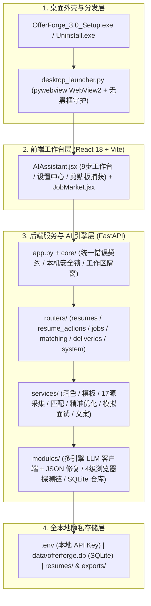

# OfferForge 3.0 — AI 全链路求职工作台（Web + Windows 原生桌面端）

> **把简历写成一款可运行的桌面产品。**  
> 从简历解析、三档温度 AI 润色、12 套高清 A4 排版直出 PDF，到 17 源多页岗位并发采集、JD 三维匹配、底线红绿灯、定向精准重写、AI 模拟面试官（盲答 + 防重换题）、4 合 1 投递文案中心与求职投递看板——**100% 本地隐私优先，自带 API Key（BYOK）开箱即用。**

---

## ✨ 核心 9 步求职闭环

| 步骤 | 模块名称 | 核心能力 |
| :---: | :--- | :--- |
| **Step 1** | **简历解析与在线微调** | 支持 PDF / Word / TXT 上传解析，带原文行号证据溯源、版本快照保护与在线表单微调 |
| **Step 2** | **智能优化简历** | 3 档改写力度（`微调 0.3` / `均衡 0.55` / `激进 0.85`）+ 智能事实护栏 + 能力缺口确认机制 |
| **Step 3** | **12 套高清简历模板** | 12 套专业排版（商务 / 现代 / 双栏 / 杂志 / 极简 / 时间轴 / 投行 / 暗夜黑金等），实时 A4 预览 + **一键静默直出高清 PDF** |
| **Step 4** | **17 源多页岗位采集** | 15 个免登录权威源（大厂官网 + 国家 24365 + 国聘 + 牛客）6 线程并发直采 + 51job / 猎聘内置 Playwright 多页直采（单源上限 30 岗） |
| **Step 5** | **JD 匹配度与底线红绿灯** | 单岗 / 批量三维评估（技能 / 经验 / 学历）+ 个人求职底线（双休 / 五险一金 / 拒绝外包等）绿黄红灯自动核查 |
| **Step 6** | **精准简历优化** | 支持「已采集高分岗」与「直接粘贴任意岗位 JD」双模式定向重写，支持一键覆盖写回与覆盖前后三维分数复测 |
| **Step 7** | **AI 模拟面试官** | 结合真实简历与目标 JD 出题，默认遮盖答案先盲答自测，提供第一人称口语示范 + STAR 拆解 + **「换一批题库」防重引擎** |
| **Step 8** | **投递文案中心（4 合 1）** | 平台打招呼开场白 / 邮箱自荐信 / 高情商内推话术 / 面试感谢与跟进，支持单岗 JD 精准定位 |
| **Step 9** | **求职投递看板** | 跨批次漏斗统计（未投递 → 已投递 → 一面中 → 不合适）、状态备注持久化与 UTF-8 CSV 一键导出 |

---

## 💻 PC 桌面端专属亮点

- **纯原生 Windows 独立窗口**：基于 `pywebview`（Windows WebView2）+ 独立 `AppUserModelID` + 7 层多分辨率原生图标，无黑框 CMD、不与浏览器任务栏混淆，关窗自动退出后台引擎。
- **4 级浏览器自动探测 + 内置兜底内核**：51job 与猎聘采集按 `Edge → Chrome → Brave/360/Vivaldi → 内置 Chrome Headless Shell` 自动探测，并具备单源故障隔离，任意 Windows 10/11（64 位）电脑开箱即用。
- **剪贴板岗位 JD 0ms 本地自动捕获**：三层纯本地防误报规则（长度门禁 + 排除代码/链接 + 职责/要求/条件多信号打分），复制 JD 切回窗口即可一键直达匹配评分、精准优化或模拟面试。
- **4 栏位「⚙️ 设置中心」**：多引擎切换（智谱 GLM / DeepSeek / 硅基流动 / 阿里百炼 / Google Gemini）+ 密钥显隐与连通性测速 + 一键打开本地目录 & ZIP 备份 + 一键场景模式预设（本地 / 面试冲刺 / 极速投递 / 深度打磨）。
- **三层大模型容错流水线**：进模型前清洗零宽空格与异常控制符 + 出模型后状态机自动修复未转义双引号/尾逗号 + 极端破损自动静默重试。

---

## 🏗️ 系统底层架构（4 层分层设计）



---

## 🚀 快速开始

### 方式一：Windows 10 / 11 一键安装版（推荐）
1. 前往本仓库右侧 **[Releases](https://github.com/Chenqifeng1109/ai-resume-assistant/releases)** 页面下载 `OfferForge_3.0_Setup.exe`；
2. 双击安装（免管理员权限，自动创建桌面与开始菜单快捷方式；若 Windows SmartScreen 首次拦截未签名独立软件，点击「更多信息 → 仍要运行」即可）；
3. 启动软件后点击右上角 **「⚙️ 设置中心 → 模型与 Key」**，填入你自己的大模型 API Key（支持智谱 / DeepSeek / 硅基流动 / 阿里百炼 / Gemini），保存即用。

### 方式二：跨平台源码运行（Windows / macOS / Linux）
```bash
# 1. 克隆仓库并安装 Python 依赖
git clone https://github.com/Chenqifeng1109/ai-resume-assistant.git
cd ai-resume-assistant
pip install -r requirements.txt

# 2. 构建前端生产产物
cd frontend
npm install && npm run build
cd ..

# 3. 启动本地 Web 服务（浏览器访问 http://localhost:5000）
python app.py
```

---

## 👤 关于作者

- **陈其锋** · 独立开发者
- 微信：`Clex620` ｜ 邮箱：`2367538177@qq.com`
- 欢迎 HR / 面试官直接下载体验，也欢迎同行与朋友交流指正！
